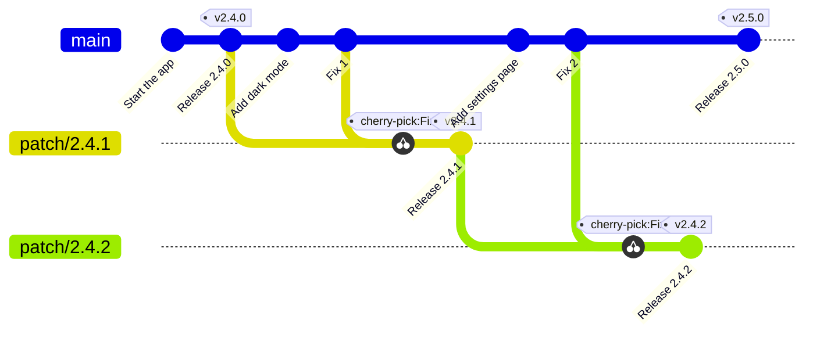

# Releases from tags: a tiny demo

A 10-minute walk through how we ship **hotfixes** without dragging along everything that is on `main`.
The repo is a toy app (a few text files), but the git history is exactly what the real flow produces.

## The idea in four rules

1. **`main` is always releasable.** No long-lived `rc` or `release` branches.
2. **A release is a tag.** `v2.4.0` points at the exact commit that shipped.
3. **A fix always lands on `main` first.** Never fix only on a patch branch.
4. **A hotfix is a short-lived branch cut from the last tag.** Cherry-pick the fix, tag it, delete the branch.
   The tag stays. The patch branch is never merged back into `main`.

## What happened in this repo



Step by step:

| Step | What we did | Result |
|------|-------------|--------|
| 1 | Released `v2.4.0` from `main` | Tag `v2.4.0` |
| 2 | Kept working on `main`: added dark mode, then **fix 1** (crash on empty name) | `main` has unreleased features |
| 3 | Created `patch/2.4.1` **from tag `v2.4.0`**, cherry-picked only fix 1, bumped the version | Dark mode is not in the patch |
| 4 | Tagged `v2.4.1`, then **deleted** `patch/2.4.1` | The tag is still there |
| 5 | `main` moved on: settings page, then **fix 2** (wrong date format) | |
| 6 | Created `patch/2.4.2` **from tag `v2.4.1`** (the branch from step 3 no longer exists), cherry-picked fix 2 | `v2.4.2` has fix 1 and fix 2, still no new features |
| 7 | Tagged `v2.4.2`, deleted the branch. Later, released `v2.5.0` from `main` | `v2.5.0` has everything |

## Try it yourself

See the whole picture:

```bash
git log --graph --all --oneline --decorate
```

There is only one branch (`main`), but the two patch commits are still there because tags point at them:

```bash
git branch -a
git tag
```

Check that the patch really has no extra features (no `dark-mode.txt`, no `settings.txt`):

```bash
git ls-tree --name-only v2.4.2
git ls-tree --name-only v2.5.0
```

See where a cherry-picked fix came from (`git cherry-pick -x` records it):

```bash
git show v2.4.1~1
```

Need a patch branch again? Recreate it from the tag any time:

```bash
git checkout -b patch/2.4.1 v2.4.1
```

## The commands behind it

```bash
# hotfix 1: cut a branch from the last release tag
git checkout -b patch/2.4.1 v2.4.0
git cherry-pick -x <fix-commit-from-main>
# bump the version, commit, then tag it
git tag -a v2.4.1 -m "Release 2.4.1"
git push origin v2.4.1
git checkout main
git branch -D patch/2.4.1        # safe: the tag keeps the commits alive

# hotfix 2: cut from the previous patch tag, not from main
git checkout -b patch/2.4.2 v2.4.1
git cherry-pick -x <second-fix-commit-from-main>
```

## FAQ

**Why can I delete the branch but not lose the commits?**
A tag is its own pointer to a commit. As long as a tag points at it, git keeps that commit and its history.

**Why is the patch branch never merged into `main`?**
It does not need to be. The fix is already on `main` (rule 3). The patch branch only holds a version bump and a copy of the fix.

**What if the bug only exists in the old version?**
Still fix it on `main` first (for example with a test that reproduces it), then cherry-pick.

**Why `-x` on cherry-pick?**
It adds a "cherry picked from commit ..." line, so you can always trace a patch commit back to `main`.
